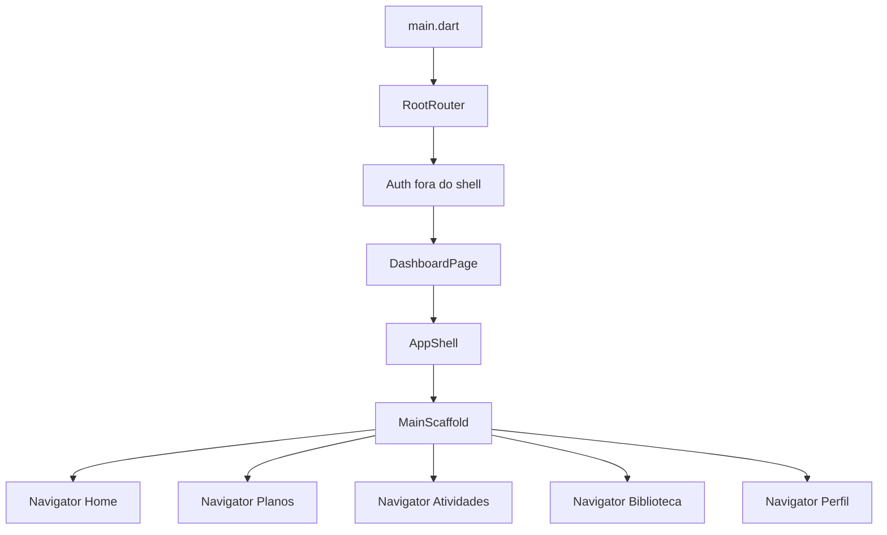

# Arquitetura Oficial do Aplicativo

## Objetivo

Este documento descreve a infraestrutura Flutter adotada no `DS3.0-M05`.
Ela organiza o aplicativo em cinco áreas raiz sem remover páginas, serviços ou
fluxos anteriores:

```text
Home | Planos | Atividades | Biblioteca | Perfil
```

A arquitetura é incremental. O código em `screens/` continua válido enquanto
cada módulo é migrado para `features/` por micro-sprints.

## Fontes de verdade

1. `designs/official-ui`;
2. `designs/design-system`;
3. regras globais do workspace;
4. esta arquitetura;
5. implementação legada, quando não houver conflito.

## Visão geral



## Responsabilidades

| Camada | Responsabilidade |
| --- | --- |
| `main.dart` | Bootstrap, tema, scroll e roteador raiz. |
| `RootRouter` | Rotas nomeadas de Auth e entrada no shell. |
| `AppShell` | Composição dos dados globais já existentes. |
| `MainScaffold` | Layout raiz, Bottom Navigation e tratamento de voltar. |
| `NavigationController` | Seção ativa, chaves dos Navigators e deep links pendentes. |
| `SectionRouter` | Registro de rotas e fallback de uma seção. |
| `SectionNavigator` | Pilha aninhada e preservada de cada seção. |
| `features/*` | Adapters, páginas, widgets, rotas e controllers por módulo. |
| `screens/*` | Implementação anterior preservada durante a migração. |

## Estrutura feature-first

```text
lib/features/
|- home/
|- plans/
|- activities/
|- library/
`- profile/
   `- presentation/
      |- controllers/
      |- pages/
      |- routes/
      `- widgets/
```

Os adapters em `presentation/pages` exibem as páginas reais atuais. Eles não
duplicam regras de negócio e podem ser removidos apenas quando a respectiva
página for migrada por completo.

## Limites dos módulos

| Módulo raiz | Conteúdo subordinado |
| --- | --- |
| Home | Dashboard diário, Coach, metas, conquistas e notificações. |
| Planos | Planos, criação e execução de musculação. |
| Atividades | Corridas, passos e demais atividades. |
| Biblioteca | Exercícios e nutrição. |
| Perfil | Evolução, Premium e Configurações. |

## Estado e dados

A sprint não moveu estado de negócio:

- corrida permanece em `RunningSessionService`;
- passos permanecem em `StepsService`;
- sincronização permanece em `SyncService`;
- dados locais permanecem em `StorageService`;
- páginas continuam usando seus controllers e services atuais.

O `NavigationController` guarda somente estado de navegação.

## Compatibilidade

- Nenhuma página antiga foi apagada.
- `DashboardPage` continua inicializando sincronização e corrida.
- `AppNavigationFrame` permanece como adapter depreciado.
- `AppRouter.buildPages` permanece disponível para consumidores antigos.
- `AppRouter.buildSectionRouters` é a composição oficial.
- Rotas internas legadas com `MaterialPageRoute` continuam funcionando dentro
  do Navigator da seção ativa.

## Regras para próximas migrações

1. Migrar uma página por micro-sprint.
2. Manter o adapter até todos os consumidores adotarem a feature.
3. Registrar a rota no arquivo `*_routes.dart`.
4. Conectar a rota ao `SectionRouter` apenas com dependências reais.
5. Preservar cache, scroll, callbacks e retorno.
6. Não mover services ou modelos apenas para completar pastas.
7. Não introduzir outro roteador ou pacote de navegação.

## Referências

- [Rotas](./ROUTING.md)
- [Navegação](./NAVIGATION.md)
- [Estrutura do shell](./SHELL_STRUCTURE.md)
- [MainScaffold](../../lib/core/navigation/main_scaffold.dart)
- [NavigationController](../../lib/core/navigation/navigation_controller.dart)

