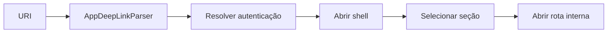

# Sistema Oficial de Rotas

## Objetivo

Centralizar nomes, separar rotas raiz das rotas internas e preparar deep links
sem alterar autenticação ou instalar uma biblioteca externa.

## Nível raiz

As constantes ficam em
[`AppRoutes`](../../lib/core/navigation/app_routes.dart).

| Constante | Path | Destino |
| --- | --- | --- |
| `splash` | `/` | Splash e resolução de sessão. |
| `onboarding` | `/auth/onboarding` | Onboarding. |
| `login` | `/auth/login` | Login. |
| `register` | `/auth/register` | Cadastro. |
| `passwordRecovery` | `/auth/password-recovery` | Recuperação. |
| `permissions` | `/auth/permissions` | Permissões iniciais. |
| `appShell` | `/app` | Entrada autenticada no shell. |

`RootRouter` é configurado no `MaterialApp`. O fluxo de Auth continua decidindo
quando `/app` pode ser aberto.

## Rotas por seção

Cada feature possui um namespace próprio:

| Seção | Arquivo | Root |
| --- | --- | --- |
| Home | `home_routes.dart` | `/home` |
| Planos | `plans_routes.dart` | `/plans` |
| Atividades | `activities_routes.dart` | `/activities` |
| Biblioteca | `library_routes.dart` | `/library` |
| Perfil | `profile_routes.dart` | `/profile` |

Rotas reservadas já possuem constantes, mas não fingem uma implementação.
Quando ainda não conectadas, abrem o placeholder oficial “Em desenvolvimento”.
Paths desconhecidos exibem erro recuperável.

## SectionRouter

Um `SectionRouter` contém:

- identificador da seção;
- builder da página raiz;
- mapa de rotas implementadas;
- conjunto de rotas declaradas para implementação futura.

Exemplo:

```dart
PlansRoutes.createRouter(
  rootBuilder: (_) => const PlansRootPage(),
);
```

Ao implementar uma rota reservada, ela deve ser adicionada ao mapa `routes`:

```dart
SectionRouter(
  section: AppShellSection.plans,
  rootBuilder: (_) => const PlansRootPage(),
  routes: {
    PlansRoutes.detail: (_, settings) => PlanDetailsPage(
      planId: settings.arguments! as String,
    ),
  },
);
```

O exemplo descreve o contrato. A conexão deve ocorrer somente quando a página
e seus argumentos reais existirem.

## Argumentos

- Usar objetos tipados ou IDs estáveis.
- Validar argumentos antes de construir uma tela.
- Não enviar services, tokens ou dados sensíveis pela rota.
- Não usar `BuildContext` como argumento.
- Query parameters de deep link devem ser convertidos antes de chegar à UI.

## Deep links

O parser aceita:

```text
fitia://planos/detail?id=plan-1
https://fitia.app/biblioteca/exercise?id=exercise-1
```

Ele produz um `AppDeepLinkTarget` sem navegar automaticamente. A autenticação
deve resolver a sessão e só então entregar o `Uri` ao `DashboardPage` ou ao
`NavigationController`.



## Migração de rotas legadas

1. Manter o `MaterialPageRoute` existente.
2. Criar constante no módulo correto.
3. Cobrir entrada, retorno e argumentos com teste.
4. Registrar o builder no `SectionRouter`.
5. Migrar o chamador para `SectionNavigationController.open`.
6. Remover o path legado somente sem consumidores.

## Regras

- Não usar strings de rota fora dos arquivos `*_routes.dart`.
- Não abrir o shell por deep link antes de validar sessão.
- Não usar a Bottom Navigation para páginas internas.
- Não criar rotas paralelas para a mesma página.
- Não substituir páginas existentes por placeholders.

