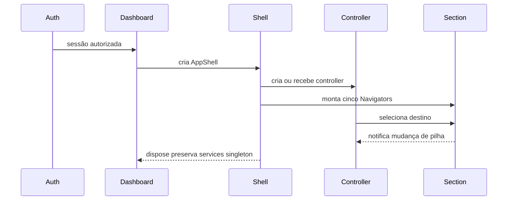

# Estrutura do App Shell

## Objetivo

Documentar a composição, o ciclo de vida e as fronteiras do shell oficial.

## Árvore de widgets

```text
FitAI
`- MaterialApp
   `- Auth
      `- DashboardPage
         `- AppShell
            `- DevModeBanner
               `- MainScaffold
                  |- IndexedStack
                  |  |- SectionNavigator(Home)
                  |  |- SectionNavigator(Planos)
                  |  |- SectionNavigator(Atividades)
                  |  |- SectionNavigator(Biblioteca)
                  |  `- SectionNavigator(Perfil)
                  `- ShellNavigation
                     `- FitBottomNavigation
```

## AppShell

`AppShell` continua responsável por compor dados que já eram globais:

- perfil resumido;
- XP e nível;
- passos;
- sessão de corrida;
- conquistas;
- callbacks de atualização.

Ele não controla mais o índice da barra diretamente. Essa responsabilidade
pertence ao `NavigationController`.

## MainScaffold

Responsabilidades:

- renderizar a seção ativa;
- manter todas as pilhas montadas;
- posicionar a Bottom Navigation;
- limitar sua largura em viewport grande;
- coordenar o evento de voltar;
- entregar deep link pendente quando o Navigator estiver pronto.

O componente não carrega dados, não acessa services e não conhece páginas de
negócio.

## SectionNavigator

A rota raiz usa `MaterialPage` declarativa. Rotas internas continuam
imperativas e são produzidas por `SectionRouter`. Essa combinação permite:

- atualizar propriedades da página raiz quando `AppShell` recebe novos dados;
- preservar rotas internas;
- manter compatibilidade com `Navigator.push`;
- preparar migração para rotas nomeadas.

## Ciclo de vida



## Adapters de módulos

| Feature | Adapter raiz | Página preservada |
| --- | --- | --- |
| Home | `HomePage` já modular | `features/home/.../home_page.dart` |
| Planos | `PlansRootPage` | `TreinosPage` |
| Atividades | `ActivitiesRootPage` | `AtividadesPage` |
| Biblioteca | `LibraryRootPage` | `BibliotecaExerciciosPage` |
| Perfil | `ProfileRootPage` | `PerfilPage` |

## Placeholders

Rotas declaradas e ainda não conectadas exibem:

- header do módulo;
- mensagem “Em desenvolvimento”;
- ação de voltar;
- componentes oficiais do Design System.

O placeholder nunca substitui uma página existente no fluxo atual.

## Invariantes

- exatamente cinco seções raiz;
- uma chave de Navigator por seção;
- Auth fora do shell;
- Bottom Navigation ausente em fluxos de Auth;
- nenhuma regra de negócio no controller de navegação;
- nenhuma dependência externa de roteamento;
- nenhuma remoção de tela durante a migração.

## Testes essenciais

- ordem oficial;
- troca de seção;
- preservação do estado raiz;
- preservação da pilha aninhada;
- retorno de seção para Home;
- Bottom Navigation em viewport largo;
- parsing de deep link;
- fallback de rota reservada;
- rotas raiz nomeadas.

