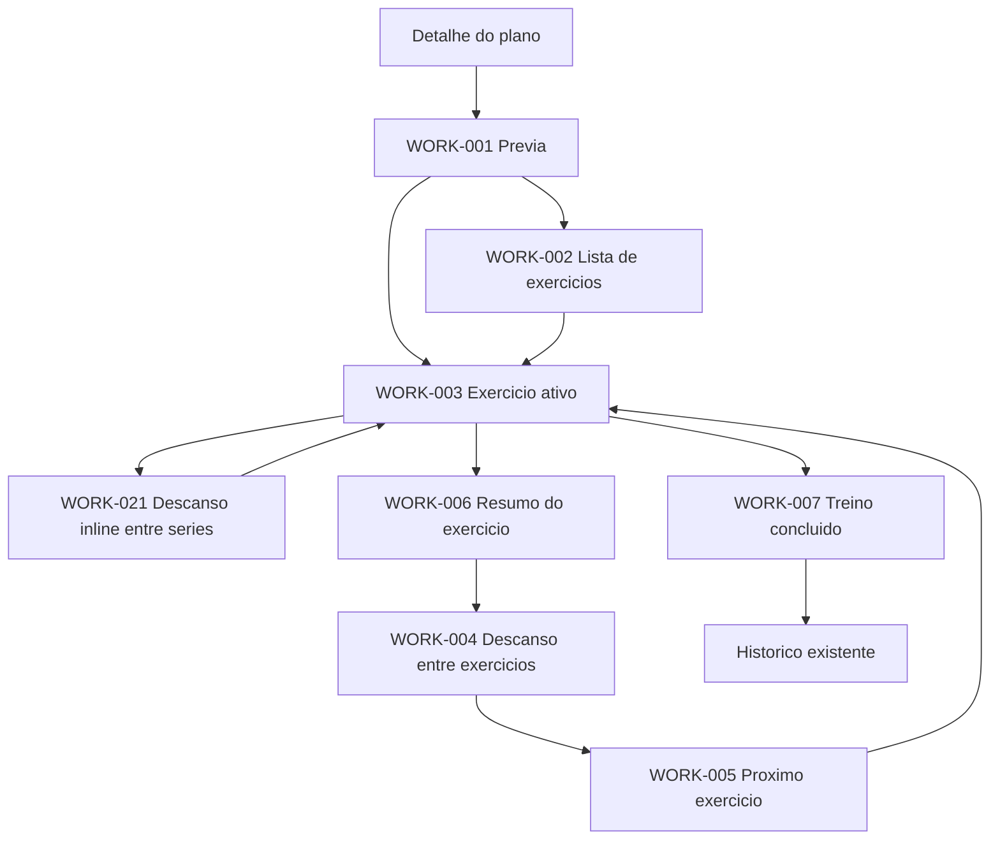

# Treino Implementation

## Escopo

UI-08 consolida a experiencia de execucao de musculacao dentro do modulo
**Planos**. A sessao continua usando `TreinoEmAndamentoPage` como a unica
fonte de estado para series, carga, descanso, XP, historico, persistencia e
sincronizacao.

Nao foi criada uma aba nova na navegacao principal.

## Fluxo

## Mapeamento das artes oficiais

| Arte | Estado | Implementacao |
| --- | --- | --- |
| WORK-001 | Implementado | `WorkoutPreviewPage` deriva metricas somente do plano. |
| WORK-002 | Preservado | `WorkoutDayPage` lista exercicios e abre detalhes. |
| WORK-003 | Atualizado | `OfficialWorkoutSession` prioriza midia, serie, carga, reps e atalhos. |
| WORK-004 | Implementado | etapa de descanso completa entre exercicios, usando o timer existente. |
| WORK-005 | Implementado | etapa de confirmacao do proximo exercicio. |
| WORK-006 | Implementado | resumo apos a ultima serie de um exercicio. |
| WORK-007 | Preservado | `TreinoFinalizadoPage` usa metricas reais da sessao. |
| WORK-008 | Preservado | resumo completo da finalizacao existente. |
| WORK-009 | Atualizado | historico combina series persistidas e series da sessao atual, com filtros de series, carga e volume. |
| WORK-010 | Preservado | progressao abre a superficie existente. |
| WORK-011 | Preservado | performance abre a superficie existente. |
| WORK-012 | Preservado | Coach usa o fluxo real e mostra fallback honesto. |
| WORK-013 | Preservado | XP abre a superficie existente. |
| WORK-014 | Preservado | troca mantem as series concluidas. |
| WORK-015 | Preservado | Biblioteca abre a ficha de execucao existente em bottom sheet. |
| WORK-016 | Preservado | notas usam o estado da sessao existente. |
| WORK-017 | Preservado | configuracoes usam o menu de edicao existente. |
| WORK-018 | Implementado | pausa congela o tempo visual sem criar outro timer. |
| WORK-019 | Preservado | encerrar confirma e salva o progresso real. |
| WORK-020 | Implementado | descarte exige confirmacao e nao grava historico. |
| WORK-021 | Implementado | descanso entre series e um widget inline no exercicio ativo. |
| WORK-022 | Preparado | `FitWorkoutMiniPlayer` existe no Design System; nao foi montado globalmente sem um gerenciador de sessao compartilhado. |

## Componentes

| Componente | Uso |
| --- | --- |
| `FitRestTimerWidget` | Possui modo `embedded` e tamanho de anel configuravel para descanso inline. |
| `FitExerciseRestScreenContent` | Descanso entre exercicios. |
| `FitNextExerciseCard` | Confirmacao do proximo exercicio. |
| `FitWorkoutCompletionHeader` | Resumo do exercicio e pausa. |
| `FitWorkoutSummaryCard` | Previa do treino. |
| `FitWorkoutCoachBubble` | Dica contextual antes do treino. |
| `WorkoutExerciseHistoryPanel` | Historico persistido e da sessao atual, sem acessar storage diretamente. |
| `FitBottomSheet` | Historico, Coach, progressao, performance, XP, biblioteca, notas e acoes adicionais. |

## Regras preservadas

- Um unico `Timer` controla o tempo da sessao e um unico `Timer` controla o descanso.
- O descanso entre series nao substitui a tela ativa.
- Apos a ultima serie, somente exercicios que ainda possuem sucessor passam pelo resumo e descanso completo.
- Pausar, encerrar e descartar sao acoes distintas.
- Dados reais permanecem prioritarios; nenhuma metrica de calorias, XP ou recorde foi inventada.
- A finalizacao existente continua salvando historico e mantendo a sincronizacao offline-first.
- O botao de concluir serie bloqueia toques duplicados enquanto a operacao esta em andamento.
- Carga e repeticoes em edicao sao preservadas ao navegar entre exercicios.
- Series concluidas mantem a identidade do exercicio original mesmo apos uma substituicao.

## Estados validados

- Sem exercicios: estado vazio existente.
- Sem historico: bottom sheet com estado explicito.
- Midia ausente: `ExercicioGifImage` mantem fallback existente.
- Coach indisponivel: fluxo real usa o fallback ja existente.
- Descanso pausado: timer nao avanca enquanto pausado.
- Tela estreita e texto ampliado: cabecalho, historico e acoes quebram para linhas seguras.

## Arquivos principais

- `lib/features/plans/workout_execution/pages/workout_preview_page.dart`
- `lib/features/plans/workout_execution/widgets/workout_history_panel.dart`
- `lib/features/plans/workout_execution/widgets/workout_execution_stages.dart`
- `lib/screens/treinos/treino_em_andamento_page.dart`
- `lib/screens/treinos/widgets/plans/official_workout_session.dart`
- `lib/screens/treinos/widgets/plans/workout_session_exercise_panel.dart`
- `lib/screens/treinos/widgets/plans/workout_session_chrome.dart`

## Pendencia consciente

O mini player nao deve ser exibido fora da pagina de treino enquanto nao existir
um estado compartilhado de sessao aprovado. Criar esse estado nesta sprint
duplicaria controle de timer, o que viola a arquitetura atual.

## Auditoria UI-08

### Fonte visual encontrada

A solicitacao da sprint cita `WORK-ALL-12` e um mapeamento antigo de Aquecimento
a Recuperacao. A pasta oficial atual nao possui esse arquivo: seu README declara
22 contratos visuais, de `WORK-001_Previa_do_Treino.png` a
`WORK-022_Mini_Player_de_Treino.png`. A implementacao e as comparacoes seguiram
os arquivos atuais, conforme a ordem de prioridade documental do projeto.

### Causa do historico vazio

O atalho de historico de `TreinoEmAndamentoPage` lia somente `_historico`, a
colecao temporaria da sessao atual. O `ExerciseHistoryService`, que reune
historico persistido, progresso legado e correspondencia por identidade do
exercicio, nao era consultado. Por isso uma sessao nova exibia "nenhuma serie
registrada" mesmo quando existiam registros salvos.

A tela agora carrega o snapshot persistido pelo servico e o combina, apenas para
apresentacao, com as series da sessao atual. O tratamento de identidade e feito
por `ExerciseIdentity`, sem alterar modelos, storage ou sincronizacao.

### Comparacao visual

As capturas da implementacao e as comparacoes lado a lado estao em:

- `artifacts/ui-08/actual/`
- `artifacts/ui-08/comparisons/`
- `artifacts/ui-08/comparisons/WORK-001-012-contact-sheet.png`

As telas WORK-001 a WORK-012 foram exercitadas. A hierarquia principal foi
preservada, mas permanecem diferencas documentadas:

- WORK-001 e WORK-003 ocupam mais altura por causa do conteudo dinamico e da UX
  de execucao aprovada posteriormente.
- WORK-002, WORK-004, WORK-005 e WORK-006 usam o fallback existente quando a
  fixture nao possui midia GymVisual.
- WORK-008 ainda usa o resumo completo existente em bottom sheet e nao replica
  o grafico segmentado da arte.
- WORK-010, WORK-011 e WORK-012 preservam o contexto da sessao em bottom sheets,
  em vez de abrir paginas isoladas.
